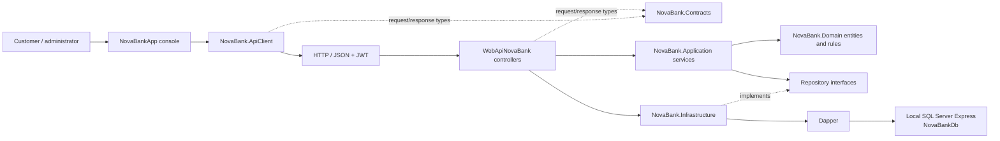
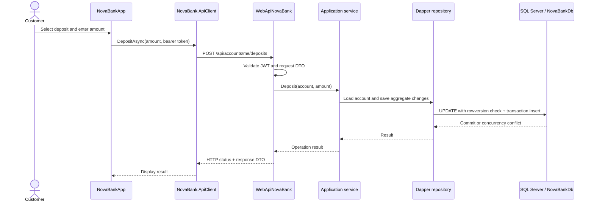
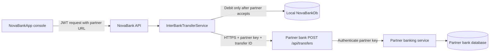

# NovaBank architecture

## Application and layer boundaries



The console is an API client. It does not create repositories, access SQL Server,
or run the banking rules itself. The API is the only application allowed to
access the database. `NovaBank.Application` owns use cases and repository
interfaces; `NovaBank.Infrastructure` implements persistence with Dapper.

## Request and persistence flow



Account balance and transaction-history writes share a SQL transaction.
`rowversion` rejects stale concurrent account updates. Incoming partner transfers
are recorded with a unique transfer ID in the same transaction as the credit, so
retries of the same transfer ID do not credit the recipient twice.

## Inter-bank communication



The receiver remains the `POST /api/transfers` controller route. It requires the
shared partner key configured on both bank APIs. Outbound calls are restricted
to the configured `InterBank:AllowedBankUrls` list. For a real deployment, use
TLS and a proper partner identity/signature arrangement rather than one shared
key, and reconcile transfers across banks; a local SQL transaction cannot make
two banks' databases atomic.

## Projects

| Project | Responsibility |
|---|---|
| `NovaBank.Domain` | Bank accounts, transactions, payment records, and domain value types |
| `NovaBank.Application` | Banking services, use cases, and repository abstractions |
| `NovaBank.Infrastructure` | Dapper repositories, SQL schema/bootstrap, and HTTP partner client |
| `NovaBank.Contracts` | API request/response DTOs shared with the console client |
| `NovaBank.ApiClient` | HTTP client used by the console application |
| `WebApiNovaBank` | ASP.NET Core controller host, authentication, authorization, and DI |
| `NovaBankApp` | Console UI that calls the API; no direct database access |

## Local database and secrets

The Development configuration points to the installed SQL Server Express
instance `localhost\SQLEXPRESS2022` using Windows Integrated Authentication.
On Development startup, the API creates `NovaBankDb` if needed and applies the
idempotent schema in `NovaBank.Infrastructure/Database/schema.sql`.

The API process's Windows identity must have permission to create the database
on its first run and then read/write its tables. Keep JWT signing keys,
administrator credentials, and the inter-bank key in .NET user-secrets or an
environment-specific secret store; never commit them.

On this workstation, the SQL Server service is installed as
`MSSQL$SQLEXPRESS2022` but was stopped during setup. Start it from an elevated
PowerShell session before running the API:

```powershell
Start-Service -Name 'MSSQL$SQLEXPRESS2022'
Get-Service -Name 'MSSQL$SQLEXPRESS2022'
```

Set the required local secrets from the repository root (use private, unique
values; do not share them or commit them):

```powershell
$project = '.\WebApiNovaBank\WebApiNovaBank.csproj'
dotnet user-secrets set 'Jwt:Issuer' 'NovaBank.Local' --project $project
dotnet user-secrets set 'Jwt:Audience' 'NovaBank.Local.Api' --project $project
dotnet user-secrets set 'Jwt:SigningKey' '<random key, at least 32 bytes>' --project $project
dotnet user-secrets set 'AdminCredentials:UserName' '<admin username>' --project $project
dotnet user-secrets set 'AdminCredentials:Password' '<admin password, at least 12 characters>' --project $project
dotnet user-secrets set 'InterBank:PartnerKey' '<random partner key, at least 32 bytes>' --project $project
```

Then start the API and console in separate terminals:

```powershell
dotnet run --project .\WebApiNovaBank\WebApiNovaBank.csproj --launch-profile http
dotnet run --project .\NovaBankApp\NovaBankApp.csproj
```

The API initializes the local database and schema in Development. On first
startup, the Windows account running the API needs SQL Server permission to
create `NovaBankDb`; if startup reports a SQL permission error, have a SQL
administrator create that database and grant the Windows account access.
